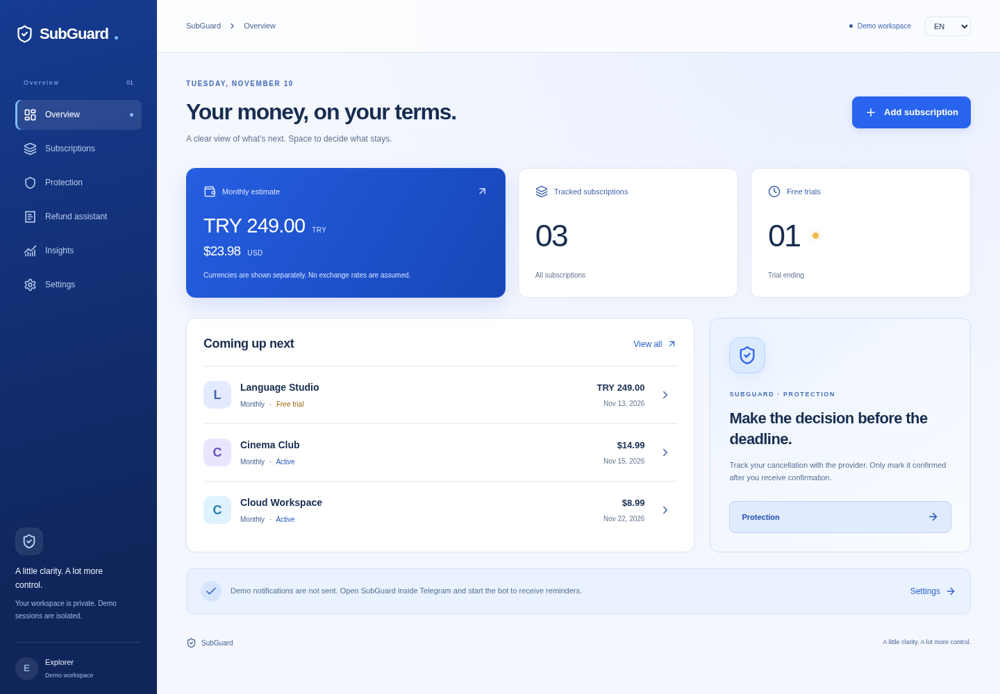

# SubGuard

**Subscription clarity, before the next charge.**

[Case study](docs/PORTFOLIO.md) · [Architecture](docs/ARCHITECTURE.md) · [Tests / Actions](https://github.com/Aydenxvi/subguard/actions) · [Demo walkthrough (RU)](docs/DEMO_SCRIPT_RU.md)

React · TypeScript · FastAPI · PostgreSQL · SQLAlchemy · aiogram · Docker

Browser demo: runs locally without Telegram credentials. A hosted public demo is not yet published.

[Download SUBGUARD_002.zip](https://github.com/Aydenxvi/subguard/raw/refs/heads/main/downloads/SUBGUARD_002.zip) — packaged source, documentation and portable Git history.

**Your subscriptions. Your decision.** A Telegram Mini App and browser application for
tracking recurring payments, free trials, cancellation requests and refund cases.
Inspired by the founder’s experience of forgotten subscriptions and unexpected charges.

This release continues the supplied backend foundation; its original Git commit is
preserved. It does not cancel subscriptions, contact providers, process payments or
promise refunds. It helps you decide, document and follow up.

## Quick start — Docker Desktop (Windows, macOS, Linux)

Install Docker Desktop with Compose v2; on Windows enable the WSL2/Linux containers backend.
Extract this project to a local directory and open a terminal there.

1. If Python 3 is installed, run `python scripts/configure_local.py` to create a new
   local demo `.env` automatically. It preserves any existing `.env`.
2. Alternatively, copy `.env.example` to `.env` (`Copy-Item .env.example .env` in PowerShell;
   `cp .env.example .env` in Bash). Fill its two secret fields manually: generate
   **two different** random values with
   `python -c "import secrets; print(secrets.token_hex(32))"`.
   Set `POSTGRES_PASSWORD` and `JWT_SECRET` in `.env`. Use hex for the database password
   so it is safe inside the connection URL. Never commit this file.
3. Run `docker compose up --build -d`.
4. Open `http://localhost:8080` in your own browser. Select **Explore the live demo**.
5. Check `docker compose ps` and `docker compose logs --tail=50 api worker migrate`.

The database is persisted in the `postgres_data` Docker volume. `docker compose down`
stops the stack without deleting it. **`docker compose down -v` destroys all data.**
The database and API are not exposed publicly. The web port binds only to loopback.
No Node or Python installation is necessary for Docker use, except optionally Python
for generating secrets (a password manager can generate the same random hex strings).

## Engineering evidence

Observed release 0.2.0 checks: **32 PostgreSQL backend tests, 3 frontend unit tests,
6 production-browser scenarios**. See [PROGRESS](PROGRESS.md) for scope and limits.
[GitHub Actions](.github/workflows/ci.yml) runs migrations, tests, builds and browser
checks on pushes and pull requests; inspect the actual Actions result before claiming CI passed.

The project continues an existing backend foundation and was developed with AI assistance.
The [case study](docs/PORTFOLIO.md) explains decisions, tradeoffs and evidence without
claiming unmeasured business results.

## What works

- Private PostgreSQL-backed user workspaces; each demo login creates a separate account.
- Telegram HMAC authentication and expiring bearer sessions.
- Create, edit, delete, pause and archive subscriptions; search, status/currency filters
  and sorting. All billing cycles, including custom days, use server-side calculations.
- Trial end and cancellation deadline tracking. First paid date is explicitly entered.
- Manual payment records, deletion and CSV export. No bank data is fabricated.
- Monthly/annual estimates, per-subscription charts and recorded payment totals.
- USD, EUR, TRY, GBP and KGS. Integer minor units; separate totals for each currency.
- Cancellation records: planned, requested, confirmed, failed. Only user-confirmed
  cancellation stops a subscription; reactivation is an explicit subscription edit.
- Refund cases, status history, follow-up dates and EN/RU/TR message drafts using the
  user’s stated facts. Copy a draft, review it and send it to the actual provider yourself.
- Durable renewal, trial, cancellation and refund reminders, retries, local quiet hours.
- aiogram `/start`, `/app`, `/help`, `/stop`, `/reminders` commands when configured.
- English, Russian and Turkish interface; responsive desktop/mobile navigation.

## Demo

Demo data uses fictional service names, real database writes and the same APIs as
Telegram users. The token is stored in sessionStorage, survives page reloads, and
expires after seven days. Separate tabs/sessions can have separate workspaces.
**Settings → Reset demo** deletes that demo account and starts a fresh one.
Demo accounts never receive Telegram messages. Signing out does not delete data.
A demo is not a durable personal account: keep real records in a Telegram account.
Disable public demo creation with `DEMO_MODE_ENABLED=false` for a private production deployment.

## Telegram setup

**Нет сервера и домена?** [Первый тест в Telegram через временный HTTPS-туннель](docs/TELEGRAM_RU.md).

1. Create a bot with @BotFather. Put its token in `TELEGRAM_BOT_TOKEN` in `.env`.
2. Deploy the web application at a public HTTPS URL (see [deployment](docs/DEPLOYMENT.md)).
3. Set `MINI_APP_URL` to that URL and configure the bot’s menu button/Mini App URL in BotFather.
4. Run `docker compose --profile telegram up --build -d`.
5. Send `/start` to the bot in a private chat, open SubGuard, and allow messaging if
   Telegram requests it. A bot cannot send notifications to a user who blocked it.
6. Set your timezone and reminder preferences. Use `/stop` to pause messages and
   `/reminders` to resume them.

Telegram tokens never enter the frontend. A browser without Telegram uses an explicit
demo button, never an unverified Telegram user ID. A forged or expired initData string
cannot create a Telegram session.

## Development

- Python 3.12; Node 22+; PostgreSQL 16; Docker Compose v2.
- Backend: `backend/app`, migration: `backend/alembic`, tests: `backend/tests`.
- Frontend: React 18, TypeScript, Vite, Tailwind, Lucide. `frontend/src`.
- Bot: `bot/app/main.py`, importing backend configuration/database services.
- Worker: `python -m app.workers.reminders` from `backend`.

For native development, create a virtual environment, install `backend/requirements.txt`,
provide `JWT_SECRET` and `DATABASE_URL`, then from `backend` run `alembic upgrade head`
and `uvicorn app.main:app --reload`. Run `npm ci` and `npm run dev` in `frontend`.
Vite proxies `/api` to port 8000. Run the worker separately. Settings read `.env` relative
to the current directory: use environment variables or a local ignored `backend/.env`.
The root Compose `.env` is not automatically loaded by a native backend in another directory.

API documentation: `/docs` on the native backend at port 8000. The public nginx site
exposes only `/api`; use backend OpenAPI in development. See [architecture](docs/ARCHITECTURE.md),
[testing](docs/TESTING.md), [deployment](docs/DEPLOYMENT.md) and [verified progress](PROGRESS.md).

## Known boundaries

Live Telegram sending needs an actual token, HTTPS deployment and a recipient who started
the bot. This release’s automated delivery tests inject a transport; they do not establish
live Telegram delivery. Provider cancellation/refund submissions remain manual.
There is no automatic FX conversion, banking connection or evidence-file upload.
The inherited category/activity models remain extension points; categories are not seeded
or shown as a finished UI feature. No dedicated Trial or RefundAttachment table is claimed.
See NEXT_STEPS.md for operations checks and optional extensions.

Deleting a subscription also removes its associated payment and cancellation records;
refund cases remain with their subscription reference cleared. Archive instead of delete
when you want to retain payment history.

The release ZIP includes `history.bundle`, a portable Git history without local Git
configuration or credentials. To inspect it, run `git clone history.bundle subguard-history`.
The normal source tree is included alongside it; no Git tooling is needed to run Docker.

## Version 0.2.0 — blue design and CSV import

The interface now uses a cobalt navigation rail and light blue/white surfaces. Page,
modal, card and chart transitions respect `prefers-reduced-motion`.

In **Subscriptions → Import CSV**, choose a UTF-8 CSV file (up to 64 KB / 200 rows),
map columns, preview the results and select valid rows to save. Download the template
from that dialog. Comma, semicolon and tab delimiters and quoted fields are supported.
Required fields: name, amount in major units (e.g. 12.50), currency, interval and
anchor_date (YYYY-MM-DD). Optional: provider, notes, is_trial (true/false or 1/0),
trial_end_date and interval_days. Custom-day billing requires interval_days.

Rows with errors are not imported. Repeated rows and subscriptions already present in
that account are skipped. A duplicate matches normalized name, amount, currency, billing
cycle/custom days, first charge and trial dates/flag. Editing notes/provider alone does not
create a new subscription. Imports are atomic and concurrent imports per user are serialized.
A subscription import is separate from payment CSV export: payment exports are not a
subscription import format. Preview does not write to the database.

Trial forms now explain the first *paid* date. Moving the trial end beyond an earlier
first payment adjusts that payment date visibly. A warning appears when the chosen
cancellation deadline falls after the first payment. Decimal commas are accepted in forms.

### Updating an existing Docker installation

Keep your current `.env` and PostgreSQL volume. Extract the new source into your project
folder (or pull the Git repository), then run `docker compose up --build -d`.
Do not replace `.env` with the template or run `down -v`. No new schema migration is
required for 0.2.0. Back up your database before updating an installation with real data.

[Desktop design preview](docs/screenshots/desktop-002.png) · [Mobile design preview](docs/screenshots/mobile-002.png)

## Portfolio presentation

See [the case study](docs/PORTFOLIO.md), [walkthrough script](docs/DEMO_SCRIPT_RU.md) and
[remaining public-demo steps](docs/PORTFOLIO_RELEASE.md). To verify local recovery tooling
without copying user data, run `python scripts/check_backup.py` with Compose running.
The check creates temporary databases, restores the application schema plus a synthetic
user, verifies it, then removes only its own temporary databases.

For a persistent HTTPS deployment, see [hosting instructions](docs/HOSTING_RU.md) and `compose.production.yaml`.
