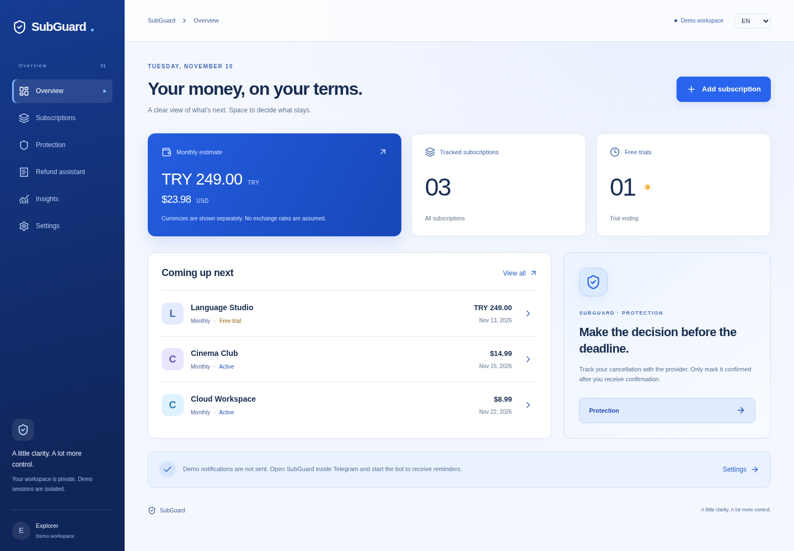
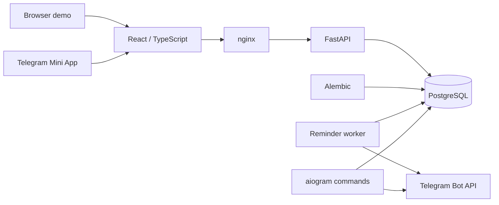

# SubGuard — portfolio case study

**A subscription protection app delivered through Telegram and a browser demo.**

[Source](https://github.com/Aydenxvi/subguard) · [Static interface showcase](https://aydenxvi.github.io/subguard/) · [Simulated bot flow](https://aydenxvi.github.io/subguard/#bot) · [Desktop](screenshots/showcase-desktop-ru.png) · [Mobile](screenshots/showcase-mobile-ru.png) · [Architecture](ARCHITECTURE.md)

## Problem

Forgotten subscriptions and trial renewals create unexpected charges. The founder’s
personal experience inspired a tool that makes the next payment and the decision deadline
visible, then helps organize cancellation and legitimate refund follow-up.

The product gives users a record and time to act. It does not claim to cancel providers,
connect to bank accounts, send refund requests or guarantee money recovery.

## Full-stack capabilities

| Area | Concrete work to demonstrate |
|---|---|
| Frontend | React state/forms, responsive UI, three locales, accessible motion, CSV preview |
| Backend | FastAPI request validation, ownership checks, signed sessions, money/date services |
| Database | PostgreSQL relations and constraints, Alembic migrations, transaction locks |
| Integrations | Telegram initData verification, aiogram commands, durable reminder delivery |
| Delivery | Docker/nginx, environment configuration, CI and isolated backup/restore checks |
| Quality | API isolation tests, billing edge cases, concurrency tests and browser workflows |

For employers, lead with a code path and its test. For clients, lead with the user workflow
and explain what is delivered, configurable and still outside scope. In both cases, be
ready to explain the implementation rather than only showing screenshots.

## What a reviewer can try

Start the Docker browser demo without Telegram credentials. Create a trial, move its end
date and see the first paid date adjust. Import the sample CSV, preview errors/duplicates
and select rows. Record an actual test payment; compare recorded totals with estimates.
Prepare a refund message in English, Russian or Turkish. Reload to verify persistence.

The public landing page gives two entry paths: try the Mini App interface with fictional
data, or explore a labelled Telegram-style command simulation. The latter runs entirely
in the browser; it does not connect to Telegram or demonstrate live message delivery.
[View the bot simulation screenshot](screenshots/showcase-bot-simulation-ru.png).

## Engineering decisions worth discussing

| Decision | Why it matters | Evidence |
|---|---|---|
| Integer minor units | Avoids floating-point money storage and rounding drift | Billing/unit tests; server estimates |
| Original billing anchor | Jan 31 returns to Mar 31 after February | Month-end billing tests |
| Separate currency totals | Does not invent an exchange rate | Analytics/API tests |
| Server-verified Telegram initData | Does not trust client Telegram IDs | HMAC/expiry/forged-session tests |
| Ownership in private queries | Prevents another account accessing a known record ID | Cross-account API tests |
| PostgreSQL reminder queue | Jobs survive worker restarts; retry state is observable | Deduplication/retry and DST tests |
| Revalidate CSV on commit | Preview cannot be used to bypass input validation | Invalid selection and import tests |
| Per-user import lock | Concurrent/repeated imports do not duplicate records | Concurrent import test |
| Explicit isolated demo | Reviewers can try real DB-backed behavior without a bot | Browser demo/reset tests |
| Reduced-motion support | Motion remains optional and does not block navigation | Mobile/reduced-motion browser test |

## Architecture

The frontend is built with Vite/Tailwind; Python uses SQLAlchemy async sessions. Docker
Compose runs database, migration, API, worker and web containers; the bot is an optional
profile. A browser session and a Telegram account use the same domain logic.

## Delivery and evidence

The project was continued from an existing Python foundation. Its Git history preserves
that baseline and the subsequent API, frontend, reminder, design and CSV milestones.
Development used AI assistance. Describe your own decisions, testing and ownership
accurately when presenting it; do not claim every line was independently handwritten.

The observed 0.2.0 validation was **32 backend tests, 3 frontend unit tests and 6 browser
scenarios** on PostgreSQL/Docker. See [PROGRESS](../PROGRESS.md) for dated evidence.
The CI workflow reruns migrations, tests, production builds and browser checks on pushes
and pull requests. A committed workflow is not itself proof of a successful hosted run;
inspect the actual [Actions results](https://github.com/Aydenxvi/subguard/actions).

## Tradeoffs and current limits

- Telegram sending is **at least once**: a crash after send but before commit can duplicate
  a message. Telegram sendMessage has no idempotency key. Routine retries/concurrency are
  handled; an exactly-once guarantee is deliberately not made.
- Cancellation/refund outcomes are user-entered records, not verified provider integrations.
- The full FastAPI/PostgreSQL/Telegram service is not publicly hosted; only the
  static interface showcase is on GitHub Pages.
- Demo accounts are isolated but not automatically expired by a retention job.
- Native Windows Docker Desktop acceptance, production load and production recovery are
  separate from the Linux development checks.
- The inherited category/activity tables are extension points, not finished user features.

There are no claimed customer counts, revenue, measured savings, production uptime or
conversion improvements. Those require real deployment evidence.

## A short project description

> SubGuard is a Telegram Mini App and browser application for subscription and trial
> tracking. It combines a React/TypeScript interface with a FastAPI/PostgreSQL backend,
> secure Telegram authentication, durable reminders and a validated CSV import flow.
> The project includes Docker deployment, EN/RU/TR localization and automated API/browser
> tests. It was developed iteratively from an existing foundation with AI assistance.

Russian version:

> SubGuard — Telegram Mini App и веб-приложение для контроля подписок и пробных периодов.
> React/TypeScript-интерфейс работает с FastAPI и PostgreSQL; реализованы авторизация
> Telegram, очередь напоминаний, учёт отмен и возвратов, CSV-импорт и локализация EN/RU/TR.
> Проект включает Docker и автоматические API/браузерные тесты. Разработка велась поэтапно
> на основе существующего backend с использованием AI-инструментов.

## What to explain at an interview or client demo

1. Trace one request from the form through validation and ownership checks to PostgreSQL.
2. Show why billing starts from an anchor and why currencies are not silently combined.
3. Explain what is durable in the reminder worker and where duplicate delivery remains possible.
4. Demonstrate a rejected cross-user request or duplicate CSV import using existing tests.
5. Discuss the next production priorities: live Telegram, demo retention, monitoring and load.
